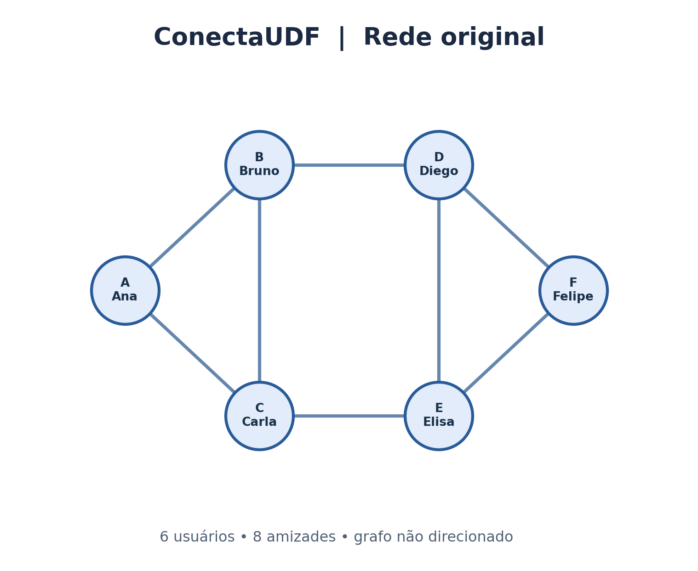
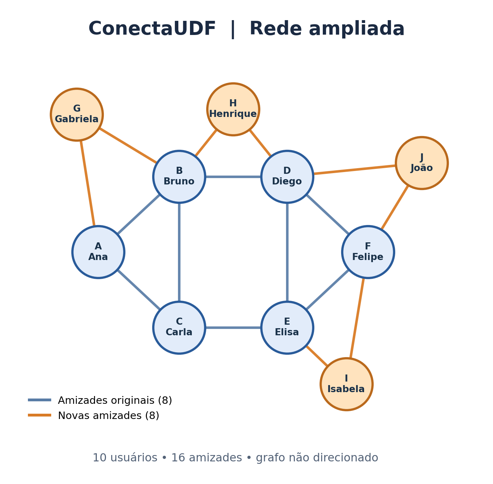

# Projeto ConectaUDF: redes sociais com grafos

**Caderno do Estudante — Atividade resolvida**  
**Aluno:** Lucas Yan Santana Caetano  
**Turma:** ____________________  
**Data:** 16/10/2026  
**Disciplina:** ESTRUTURA DE DADOS 2

## 1. O desafio

O projeto representa uma rede social fictícia por um **grafo simples não direcionado**: cada usuário é um vértice, e cada amizade recíproca é uma aresta. A atividade aborda desenho do grafo, grau dos vértices, número de amizades, densidade, caminhos, representação em Python e ampliação da rede.

## 2. Conceitos essenciais

- **Vértice (nó):** usuário da rede social.
- **Aresta:** amizade entre dois usuários.
- **Grau:** quantidade de amigos diretos de um usuário.
- **Caminho:** sequência de usuários ligados por amizades consecutivas.
- **Densidade:** proporção de amizades existentes em relação ao máximo possível.
- **Grafo não direcionado:** se Ana é amiga de Bruno, Bruno também é amigo de Ana.

## 3. Conheça os usuários

| Código | Usuário |
|:---:|---|
| A | Ana |
| B | Bruno |
| C | Carla |
| D | Diego |
| E | Elisa |
| F | Felipe |

**As 8 amizades fornecidas no enunciado:**

1. Ana — Bruno
2. Ana — Carla
3. Bruno — Carla
4. Bruno — Diego
5. Carla — Elisa
6. Diego — Elisa
7. Diego — Felipe
8. Elisa — Felipe

## 4. Passo a passo: desenho do grafo



Cada círculo representa um dos seis usuários, com seu nome e código. Cada linha representa exatamente uma das oito amizades listadas no enunciado. Não há linhas duplicadas nem setas, porque as amizades são recíprocas.

## 5. Passo a passo: cálculo do grau

| Usuário | Amigos diretos | Grau |
|---|---|:---:|
| Ana | Bruno, Carla | **2** |
| Bruno | Ana, Carla, Diego | **3** |
| Carla | Ana, Bruno, Elisa | **3** |
| Diego | Bruno, Elisa, Felipe | **3** |
| Elisa | Carla, Diego, Felipe | **3** |
| Felipe | Diego, Elisa | **2** |

**Pergunta 1 — Quem tem mais conexões diretas?**  
**Resposta:** Bruno, Carla, Diego e Elisa, empatados com **3 conexões** cada.

## 6. Passo a passo: número de amizades

Em um grafo não direcionado, cada amizade aparece no grau de seus dois participantes:

**Número de arestas = soma dos graus ÷ 2**

1. **Soma dos graus:** `2 + 3 + 3 + 3 + 3 + 2 = 16`.
2. **Divisão por 2:** `16 ÷ 2 = 8`.
3. **Quantidade de amizades no grafo:** **8**.

## 7. Passo a passo: cálculo da densidade

Para um grafo simples não direcionado:

$$
D = \frac{2E}{V(V-1)}
$$

Onde `D` é a densidade, `E` é o número de arestas e `V` é o número de vértices.

- **V = 6** usuários.
- **E = 8** amizades.
- **Substituição:** `D = 2 × 8 / (6 × (6 − 1))`.
- **Resultado:** `D = 16 / 30 = 8 / 15 ≈ 0,5333`.
- **Resultado percentual:** **53,33%**.

**Interpretação:** entre as `6 × 5 / 2 = 15` amizades diferentes que seriam possíveis, existem 8. Portanto, a rede possui **um pouco mais da metade das conexões possíveis**; há ligações importantes, mas ainda existem 7 pares de usuários sem amizade direta.

## 8. Passo a passo: representação do grafo em Python

O código executável completo está no arquivo **[`conecta_udf.py`](conecta_udf.py)**, incluído neste repositório. O programa utiliza listas de adjacência, imprime o grau de cada usuário, calcula quantidade de arestas e densidade, encontra um caminho entre Ana e Felipe, analisa a rede ampliada e apresenta recomendações de amizades.

A parte inicial da lista de adjacência é:

```python
rede = {
    "Ana": ["Bruno", "Carla"],
    "Bruno": ["Ana", "Carla", "Diego"],
    "Carla": ["Ana", "Bruno", "Elisa"],
    "Diego": ["Bruno", "Elisa", "Felipe"],
    "Elisa": ["Carla", "Diego", "Felipe"],
    "Felipe": ["Diego", "Elisa"]
}

n = len(rede)
for usuario, amigos in rede.items():
    print(usuario, "tem", len(amigos), "conexões")

soma_graus = sum(len(amigos) for amigos in rede.values())
arestas = soma_graus // 2

densidade = (2 * arestas) / (n * (n - 1))
print("Total de usuários:", n)
print("Total de amizades:", arestas)
print(f"Densidade: {densidade:.2%}")
```

**Resultado esperado para a rede original:**

```text
Ana tem 2 conexões
Bruno tem 3 conexões
Carla tem 3 conexões
Diego tem 3 conexões
Elisa tem 3 conexões
Felipe tem 2 conexões
Total de usuários: 6
Total de amizades: 8
Densidade: 53.33%
```

## 9. Passo a passo: encontre um caminho

**Caminho 1:** Ana → Bruno → Diego → Felipe.  
**Quantidade de arestas:** **3**.

**Existe outro caminho com a mesma quantidade de arestas?**  
**Sim. Caminho 2:** Ana → Carla → Elisa → Felipe, também com **3 arestas**.

Ambos são caminhos válidos, e não há um caminho com 1 ou 2 arestas entre Ana e Felipe. Logo, a distância mínima entre eles é **3 arestas**.

## 10. Desafio em grupo: ampliação da rede

### 10.1. Quatro novos usuários fictícios

| Código | Novo usuário |
|:---:|---|
| G | Gabriela |
| H | Henrique |
| I | Isabela |
| J | João |

### 10.2. Oito novas amizades criadas

1. Ana — Gabriela
2. Bruno — Gabriela
3. Bruno — Henrique
4. Diego — Henrique
5. Elisa — Isabela
6. Felipe — Isabela
7. Diego — João
8. Felipe — João

São **8 novas amizades**, atendendo ao mínimo de 5. As 8 originais foram mantidas, e nenhuma amizade foi duplicada.

### 10.3. Grafo da rede ampliada



As **linhas azuis** representam amizades originais; as **linhas laranja**, as oito amizades adicionadas. Os novos usuários aparecem em círculos laranja-claros.

### 10.4. Lista de adjacência atualizada

A lista também é construída e utilizada automaticamente pelo arquivo `conecta_udf.py`.

```python
rede_ampliada = {
    "Ana": ["Bruno", "Carla", "Gabriela"],
    "Bruno": ["Ana", "Carla", "Diego", "Gabriela", "Henrique"],
    "Carla": ["Ana", "Bruno", "Elisa"],
    "Diego": ["Bruno", "Elisa", "Felipe", "Henrique", "João"],
    "Elisa": ["Carla", "Diego", "Felipe", "Isabela"],
    "Felipe": ["Diego", "Elisa", "Isabela", "João"],
    "Gabriela": ["Ana", "Bruno"],
    "Henrique": ["Bruno", "Diego"],
    "Isabela": ["Elisa", "Felipe"],
    "João": ["Diego", "Felipe"]
}
```

### 10.5. Graus após a ampliação

| Usuário | Amigos diretos | Grau |
|---|---|:---:|
| Ana | Bruno, Carla, Gabriela | **3** |
| Bruno | Ana, Carla, Diego, Gabriela, Henrique | **5** |
| Carla | Ana, Bruno, Elisa | **3** |
| Diego | Bruno, Elisa, Felipe, Henrique, João | **5** |
| Elisa | Carla, Diego, Felipe, Isabela | **4** |
| Felipe | Diego, Elisa, Isabela, João | **4** |
| Gabriela | Ana, Bruno | **2** |
| Henrique | Bruno, Diego | **2** |
| Isabela | Elisa, Felipe | **2** |
| João | Diego, Felipe | **2** |

**Soma dos graus:** `3 + 5 + 3 + 5 + 4 + 4 + 2 + 2 + 2 + 2 = 32`.

**Número de arestas:** `E = 32 / 2 = 16`.

**Densidade:** `D = (2 × 16) / (10 × (10 − 1)) = 32 / 90 ≈ 0,3556 = 35,56%`.

### 10.6. Comparação antes e depois

| Indicador | Antes | Depois |
|---|:---:|:---:|
| Usuários (vértices) | 6 | 10 |
| Amizades (arestas) | 8 | 16 |
| Soma dos graus | 16 | 32 |
| Máximo de amizades possíveis | 15 | 45 |
| Densidade | **53,33%** | **35,56%** |

A rede **dobrou o número de amizades**, mas a densidade **diminuiu cerca de 17,78 pontos percentuais**. Isso ocorre porque a quantidade de pares possíveis aumentou de 15 para 45, ou seja, mais rapidamente do que as amizades efetivamente criadas.

### 10.7. Usuários com mais conexões

**Bruno e Diego** têm o maior grau da rede ampliada, com **5 amigos diretos cada**.

### 10.8. Como recomendar uma nova amizade?

O sistema pode verificar **amigos em comum entre dois usuários que ainda não são amigos** e sugerir a conexão para aqueles com maior quantidade de amigos compartilhados. Por exemplo, **Bruno e Elisa ainda não são amigos diretos, mas ambos têm Carla e Diego como amigos**, de modo que uma sugestão entre eles faz sentido.

A quantidade de amigos em comum é apenas um critério de recomendação. A rede não deve criar amizades automaticamente e precisa respeitar as preferências e a privacidade dos usuários.

## 11. Entrega — itens atendidos

- [x] Desenho do grafo original (seção 4 e imagem `grafo_original.png`).
- [x] Tabela com os graus (seção 5).
- [x] Cálculos de arestas e densidade (seções 6 e 7).
- [x] Código Python executável (`conecta_udf.py`).
- [x] Respostas às perguntas, caminhos e conclusão (seções 5, 9, 10 e conclusão).
- [x] Ampliação com quatro usuários e oito novas amizades, incluindo desenho, tabela e cálculos (seção 10).
- [x] Resposta à pergunta de reflexão (seção 12).

## 12. Pergunta de reflexão

**Duas pessoas ainda não são amigas, mas têm três amigos em comum. Como essa informação poderia ser usada para sugerir uma nova conexão? Quais cuidados de privacidade devem ser considerados?**

O sistema pode identificar que essas duas pessoas compartilham três amizades e **oferecer uma sugestão de conexão**, pois há maior chance de se conhecerem ou terem interesses próximos. Entretanto, ter amigos em comum **não significa que as pessoas desejem se conectar**. A recomendação deve respeitar as configurações de privacidade, evitar expor listas privadas de amigos ou dados sensíveis, usar somente os dados necessários e permitir que cada usuário ignore ou desative recomendações. A amizade só deve ser criada se as duas pessoas aceitarem.

## Conclusão

A atividade demonstrou como os grafos representam relações em redes sociais e permitem calcular conexões, identificar usuários mais ligados, encontrar caminhos e medir a densidade. A rede inicial tinha **6 usuários, 8 amizades e 53,33% de densidade**. Após a ampliação, passou a ter **10 usuários e 16 amizades**, mas sua densidade caiu para **35,56%**, pois o total de conexões possíveis cresceu mais rapidamente. O Python facilitou os cálculos e permitiu explorar sugestões de amizades com base em conexões compartilhadas.

## Como executar o projeto

1. Abra o repositório no GitHub e consulte este `README.md`, que contém as respostas e os desenhos.
2. Baixe os arquivos ou clone o repositório em um computador com **Python 3** instalado.
3. No terminal, dentro da pasta do projeto, execute:

   ```bash
   python conecta_udf.py
   ```

4. Opcionalmente, para executar os testes automáticos:

   ```bash
   python -m unittest test_conecta_udf.py -v
   ```

**Observação:** o programa utiliza apenas módulos da biblioteca padrão do Python; não é necessário instalar pacotes extras para executá-lo. As imagens dos grafos já estão incluídas no projeto.
